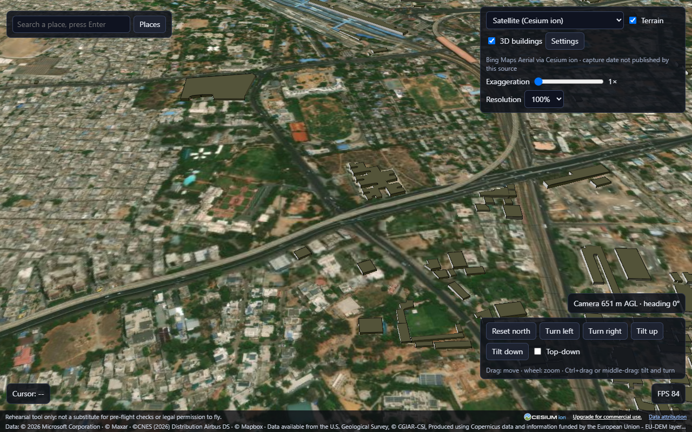
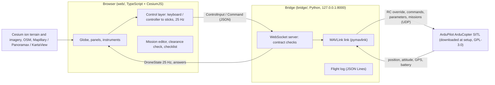

# Drone World Simulator

Fly a simulated quadcopter over real 3D terrain anywhere on Earth, in your browser. The flight brain is the real
ArduPilot autopilot running as a simulator (SITL) on your computer; the world is CesiumJS with real terrain, satellite
imagery and street-level photos. Use it to rehearse a flight: plan a route, check it against the terrain, practise with
the keyboard or a game controller, add wind, weak GPS or a draining battery, and replay the flight log afterwards.

> **Rehearsal tool only: not a substitute for pre-flight checks or legal permission to fly.** No warranty (Apache-2.0,
> section 7). Terrain heights carry about 25 m of uncertainty, and buildings, trees, poles and wires are not obstacle data.



**Tested on Windows 11 only.** The simulator download script is for Windows; Linux and macOS are a roadmap item
(docs/ROADMAP.md).

## What works and what does not

| Area | Status |
|---|---|
| Globe: real terrain, satellite imagery, search, saved places, coordinates and ground height at any click | works (terrain and imagery need a free Cesium ion token) |
| Street level: Stand here, drone-eye view, 360 photos (Mapillary, Panoramax, KartaView), a 360 coverage layer | works where those services have pictures; coverage is uneven (see Limits) |
| Drone: place anywhere, take off, fly by keyboard or game controller, flight modes, instruments, crash against real terrain | works with ArduPilot SITL on Windows |
| Conditions: wind presets, GPS good / weak / dropout, battery start charge and drain with the autopilot's own failsafes | works |
| Missions: waypoint editor, terrain clearance check with height chart, upload and fly in Auto, geofence with breach action, pre-flight checklist | works |
| Parameter profile: read, save, load, export a whitelisted `.param` file | works (return height, speeds, geofence, failsafes, flight modes only) |
| Flight log, replay with a timeline, summary, CSV and KML export | works |
| Key press to visible motion | about 350 ms median, most of it the simulated autopilot's own response; the 200 ms goal is not met |
| Linux and macOS, real drones, multiplayer, photorealistic 3D cities | not done (roadmap) |

## How it works



The browser never talks to the autopilot directly. Every message between browser and bridge follows one contract
(`web/src/net/contract.ts` and `bridge/contract.py`, both tested against `docs/contract.fixtures.json`). The bridge
starts the simulator when you press **Place drone here**, with its home at the clicked point.

## Quick start

### Prerequisites
- Windows 11, Node.js 22, Python 3.11, a browser with WebGL (Edge or Chrome), about 2 GB of free memory.
- A free **Cesium ion** account for terrain and imagery: sign up at https://ion.cesium.com/signup, open *Access Tokens*,
  and copy the default token. The Community plan is for personal and non-commercial use (see THIRD_PARTY.md).
- Optional: a **Mapillary** client token for 360 photos: https://www.mapillary.com/dashboard/developers, register an
  application and copy its *client token* (never use the client secret in a browser app).

### Tokens
```
copy web\.env.example web\.env.local
```
Fill in `VITE_CESIUM_ION_TOKEN` (and `VITE_MAPILLARY_TOKEN` if you have one). `web/.env.local` is git-ignored.

### Install and run the web app
```
cd web
npm ci
npm run dev          # http://127.0.0.1:3003
```

### The simulator (ArduPilot SITL)
```
powershell -File sim\start-sitl.ps1
```
The first run downloads ArduPilot's own prebuilt Windows SITL (ArduCopter.elf and its Cygwin DLLs) from
`https://firmware.ardupilot.org/Tools/MissionPlanner/sitl/CopterStable` into `sim\sitl-win` (git-ignored), then starts
it bound to 127.0.0.1 with `sim/copter-min.parm`. Stop it with Ctrl+C. After the first download you do not need to run
it yourself: the bridge starts and stops the simulator.

### The bridge
```
python -m venv bridge\.venv
bridge\.venv\Scripts\pip install -r bridge\requirements.txt
bridge\.venv\Scripts\python bridge\ws_server.py
```
Open the app, click the ground, press **Place drone here**, then T to take off (or Enter to arm first). Keys: W/S
throttle, A/D yaw, arrows pitch and roll, 1/2/3 Loiter, AltHold, Stabilize, H return home, L land, C camera, Esc
centres the sticks.

### Tests
```
cd web && npm test                         # unit tests (no token, no GPU)
npm run build                              # type check and production build
bridge\.venv\Scripts\python -m pytest bridge\tests -q
```
The browser checks in `web/e2e/` drive an installed Edge: most need a Cesium token and a GPU, and the `*-live` ones
also need the simulator. See CONTRIBUTING.md.

## Project layout
```
web/        browser app: globe, panels, input, drone model, missions (TypeScript, Vite, CesiumJS)
  e2e/      headless browser checks (Playwright driving installed Edge)
bridge/     Python bridge: WebSocket server, MAVLink link, commands, flight log, export; tests/ (pytest and live checks)
sim/        simulator start script, parameter file, measurement scripts
data/       place lists, parameter whitelist, coverage survey results
scripts/    one-off data scripts (coverage survey, place lists, drone model)
docs/       decisions, data sources, coverage reports, tuning, contract fixtures, roadmap
```

## Roadmap
See docs/ROADMAP.md: good first issues with acceptance criteria, including a Linux and macOS simulator start script.

## Honest limits
- **Terrain:** clearance uses terrain heights only, shown with at least 25 m uncertainty (the worst error measured
  against trusted heights was 24.7 m). The default minimum margin is 50 m.
- **Buildings are not obstacle data.** OpenStreetMap buildings are drawn as a visual aid; most have no mapped height.
  Trees, poles and wires are missing. Do not use the app for clearance from structures.
- **360 coverage is uneven.** In a survey of 1,015 large places, 25 % had a true 360 photo within 500 m (Europe and the
  Americas most, Asia and Africa least); elsewhere the app falls back to flat photos or the 3D view
  (docs/world-coverage-survey.md).
- **Simulation is not reality.** The simulated drone, wind, GPS and battery follow ArduPilot's simulator models. A real
  drone needs its own checks, tuning and calibration; exported parameter files say so.
- The simulator's ground under the drone is flat at the home height; the app stops the drone where it meets the real
  terrain.

## Safety
Rehearsal tool, not a substitute for pre-flight checks or legal permission to fly. Follow your local aviation rules.
The software is provided "AS IS", without warranties or conditions of any kind (LICENSE, section 7).

## Credits and attribution
Built on CesiumJS, ArduPilot, pymavlink, MapillaryJS and Pannellum, with data from Cesium ion (Cesium World Terrain, Bing
Maps imagery), OpenStreetMap contributors, Mapillary, Panoramax and KartaView contributors, EOX Sentinel-2 cloudless and
Natural Earth. Every licence and attribution rule is in THIRD_PARTY.md; the app shows the required credits on screen.

## Licence
Apache-2.0 (LICENSE, NOTICE). Contributions are accepted under the same licence (CONTRIBUTING.md).
